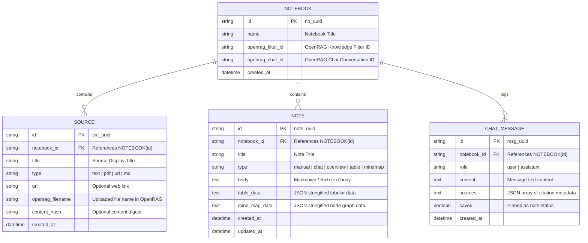

# System Architecture & Technical Design: OpenRAG Notebook App

## 1. Data Model

### 1.1 Local Relational Data Model (SQLite)

---

## 2. OpenRAG Knowledge Filters Integration

OpenRAG uses **Knowledge Filters** to isolate vector search scopes for specific query streams.

### Filter Lifecycle & Mapping
1. **Creation**: When a user creates a new notebook, the application calls `openrag.knowledgeFilters.create()` with:
   - `name`: Notebook Title (`nb_<id>`)
   - `description`: "Auto-generated knowledge filter for Notebook <name>"
   - `queryData`: `{ query: "*", filters: { data_sources: [] } }`
2. **Binding**: The returned `filter_id` is saved into `NOTEBOOKS.openrag_filter_id`.
3. **Source Ingestion & Scope**: When a file is uploaded via `openrag.documents.ingest()`, its `filename` is added to the filter's `data_sources` payload using `openrag.knowledgeFilters.update()`.
4. **Scoped Query Execution**:
   - Chat queries (`openrag.chat.create({ message, filterId })`) restrict RAG context retrieval strictly to the documents registered under the notebook's filter.
   - Direct searches (`openrag.search.query({ query, filterId })`) filter vector embeddings to matching notebook sources.

---

## 3. Technical Requirements

### 3.1 Frontend Requirements
- **Framework**: Next.js App Router (React)
- **UI & Components**: Responsive workspace with split-pane layout:
  - Left panel: Sources List (upload, toggle, view raw text).
  - Center panel: Dynamic Canvas (Notes, Generated Summary, Tables, Interactive Mind Maps using React Flow / SVG).
  - Right panel: Grounded Chat interface with inline citations.
- **State Management**: React state hooks & optimistic UI updates.

### 3.2 Backend Requirements
- **Server API**: Next.js Server Components / API Route Handlers.
- **Database Engine**: Embedded SQLite database (`node:sqlite`) for zero-dependency local storage.
- **OpenRAG Integration**: `openrag-sdk` TypeScript client to handle document ingestion, knowledge filter lifecycle, and conversational RAG streams.
